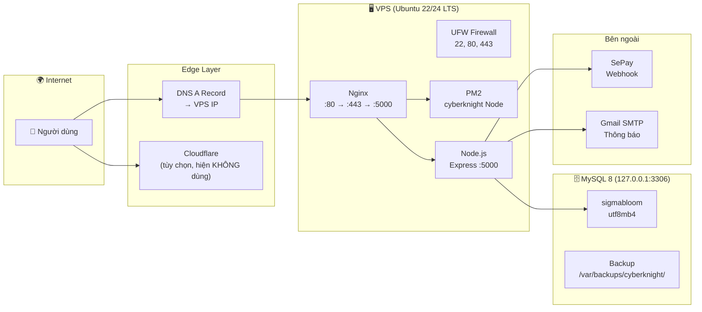

# 📡 MONITORING.md — Sổ Tay Vận Hành Dài Hạn CyberKnight / Sigmabloom

> **Mục đích:** playbook vận hành cho sysadmin/developer sau khi deploy thành công.
> Phiên bản: Phase 3 (Tháng 10/2026). Cập nhật định kỳ mỗi quý.
>
> **Nguyên tắc:** KISS (Keep It Simple, Stupid) — giai đoạn này chỉ dùng công cụ có sẵn,
> không cài ELK/Loki/Grafana. Khi > 1000 user/ngày, cân nhắc nâng cấp.

---

## 1. Tổng Quan Kiến Trúc

### 1.1. Sơ đồ kiến trúc



### 1.2. Ba lớp monitoring

| Lớp | Phạm vi | Công cụ chính |
|------|---------|--------------|
| **Infrastructure** | CPU, RAM, Disk, Network, UFW, fail2ban | `htop`, `df`, `ss`, `pm2 monit`, logrotate |
| **Application** | Node process, PM2 logs, MySQL slow queries, access/error logs | `pm2 logs`, `mysql slow query log`, nginx logs |
| **Business** | Uptime, health check, backup thành công, doanh thu, user mới | healthchecks.io, UptimeRobot, Telegram alert |

---

## 2. Infrastructure Monitoring

### 2.1. Giám sát tài nguyên real-time

```bash
# CPU + RAM + Processes (cài khi cần: apt install htop)
htop

# I/O Disk (cài: apt install iotop)
sudo iotop -o

# Network per process (cài: apt install nethogs)
sudo nethogs

# PM2 real-time dashboard
pm2 monit

# Disk usage summary
df -h /

# Top RAM-consuming directories in logs
du -sh /opt/cyberknight/logs/*
du -sh /var/backups/cyberknight/*
```

### 2.2. Logrotate cho Nginx

Kiểm tra cấu hình logrotate tự động chạy mỗi ngày:

```bash
cat /etc/logrotate.d/nginx
# Cần đảm bảo có:
#   daily          (xoay mỗi ngày)
#   rotate 14     (giữ 14 bản)
#   compress       (nén .gz)
#   delaycompress  (nén bản hôm qua, không nén bản hôm nay)
#   notifempty    (không xoay file rỗng)
#   create 0640 www-data adm  (tạo file mới ngay)
```

Nếu không có, tạo file `/etc/logrotate.d/cyberknight`:

```bash
sudo tee /etc/logrotate.d/cyberknight <<'EOF'
/var/log/nginx/access.log /var/log/nginx/error.log {
    daily
    rotate 14
    compress
    delaycompress
    notifempty
    create 0640 www-data adm
    sharedscripts
    postrotate
        [ -f /var/run/nginx.pid ] && kill -USR1 `cat /var/run/nginx.pid`
    endscript
}
/opt/cyberknight/logs/*.log {
    daily
    rotate 7
    compress
    notifempty
    create 0640 deployer deployer
    missingok
}
EOF
sudo chmod 644 /etc/logrotate.d/cyberknight
```

### 2.3. SSL Certificate Renewal

Certbot gia hạn tự động qua **systemd timer** (không cần cron). Kiểm tra mỗi tháng:

```bash
# Dry-run để xác nhận sẽ thành công
sudo certbot renew --dry-run

# Kiểm tra timer đang chạy
systemctl status certbot.timer

# Xem lần chạy gần nhất
sudo certbot renew --dry-run 2>&1 | tail -5
```

> **Lưu ý:** Certificate có thời hạn 90 ngày. Certbot renew tự động khi còn 30 ngày.
> Timer systemd chạy 2 lần/ngày. Không cần can thiệp trừ khi dry-run báo lỗi.

### 2.4. Theo dõi Disk space

```bash
# Disk theo filesystem
df -h

# Top 10 thư mục lớn nhất trong /opt/cyberknight
sudo du -sh /opt/cyberknight/* 2>/dev/null | sort -rh | head -10

# Backup disk (kiểm tra không đầy)
du -sh /var/backups/cyberknight/
ls -lhS /var/backups/cyberknight/*.sql.gz 2>/dev/null | head -5
```

---

## 3. Application Monitoring

### 3.1. PM2 Logs — kiểm tra lỗi

```bash
# 200 dòng log gần nhất, filter ERROR/FATAL
pm2 logs cyberknight --lines 200 --nostream | grep -iE 'error|fatal|unhandled|warning' | tail -30

# Real-time log stream
pm2 logs cyberknight --lines 50 --nostream

# Xem chỉ stderr (lỗi)
pm2 logs cyberknight --err --lines 100 --nostream

# Restart count + uptime
pm2 show cyberknight
```

**Ngưỡng cảnh báo:**
- ERROR stack trace liên tục (> 5 lần/phút) → có bug hoặc DB chết.
- "Too many unhandled rejections" → memory leak hoặc promise không catch.

### 3.2. MySQL Slow Query Log

Bật slow query log (tổng thời gian query > 2 giây):

```bash
# Tạo file cấu hình MySQL riêng
sudo tee /etc/mysql/mysql.conf.d/zz-cyberknight.cnf <<'EOF'
[mysqld]
slow_query_log      = 1
slow_query_log_file = /var/log/mysql/slow-query.log
long_query_time     = 2
log_queries_not_using_indexes = 0
EOF

# Tạo file log và set quyền
sudo touch /var/log/mysql/slow-query.log
sudo chown mysql:mysql /var/log/mysql/slow-query.log
sudo systemctl restart mysql

# Xem 20 query chậm gần nhất
sudo mysqldumpslow -s t -r /var/log/mysql/slow-query.log | head -40
# Hoặc: cat /var/log/mysql/slow-query.log | grep -v "^SELECT" | tail -20
```

### 3.3. Bốn loại log và đường dẫn

| Loại | Đường dẫn | Mô tả | Xem |
|------|-----------|--------|-----|
| **Nginx access** | `/var/log/nginx/access.log` | Mọi request vào server | `tail -50 /var/log/nginx/access.log` |
| **Nginx error** | `/var/log/nginx/error.log` | Lỗi Nginx (502, 504, config) | `tail -30 /var/log/nginx/error.log` |
| **App (PM2 out)** | `/opt/cyberknight/logs/out.log` | Console.log từ Node | `pm2 logs cyberknight --out --lines 50` |
| **App (PM2 err)** | `/opt/cyberknight/logs/error.log` | Uncaught error, crash | `pm2 logs cyberknight --err --lines 50` |
| **MySQL error** | `/var/log/mysql/error.log` | Lỗi MySQL startup, crash | `sudo tail -30 /var/log/mysql/error.log` |
| **MySQL slow** | `/var/log/mysql/slow-query.log` | Query chạy > 2s | `sudo tail -20 /var/log/mysql/slow-query.log` |

### 3.4. Nâng cấp khi lớn (khi > 1000 user/ngày)

Hiện tại dùng log đơn giản. Khi cần:

- **ELK Stack (Elasticsearch + Logstash + Kibana):** thu thập + phân tích log tập trung.
- **Loki + Grafana:** thay thế nhẹ hơn ELK, tích hợp tốt với Prometheus.
- **Sentry:** theo dõi lỗi JavaScript phía frontend (frontend errors).
- **Prometheus + node_exporter:** metrics infrastructure (CPU, RAM, disk theo thời gian).

---

## 4. Health Check & Alerting

### 4.1. healthchecks.io (miễn phí, khuyến nghị)

**Tạo tài khoản:** https://healthchecks.io → Tạo ping URL.

```bash
# Cài cron job chạy mỗi 5 phút
crontab -e

# Thêm dòng:
*/5 * * * * curl -fsS -m 10 --retry 3 https://hc-ping.com/<YOUR_UUID> >> /dev/null 2>&1
```

- **Timeout 10 giây** (`-m 10`) — tránh cron bị block.
- **`--retry 3`** — tự retry nếu mạng lag.
- **Nếu cron không chạy đúng 5 phút** → healthchecks.io báo "DOWN".

### 4.2. UptimeRobot (miễn phí, 50 monitors)

**Đăng ký:** https://uptimerobot.com

1. Thêm monitor mới → loại: **HTTP(s)**.
2. Friendly name: `CyberKnight Health`.
3. URL: `https://<TEN_MIEN>/api/health`.
4. Monitoring interval: **5 minutes**.
5. Alert contacts: email / Telegram / Slack.

**Cảnh báo khi:**
- `/api/health` không trả 200 trong **5 phút**.
- SSL certificate sắp hết hạn.

### 4.3. Telegram Bot (tùy chọn, cảnh báo real-time)

**Tạo bot:**

1. Chat với **@BotFather** trên Telegram.
2. Gửi `/newbot`, đặt tên → nhận **`<BOT_TOKEN>`**.
3. Chat với bot mới → gửi tin nhắn bất kỳ.
4. Lấy **`<CHAT_ID>`** bằng:
   ```bash
   curl -s "https://api.telegram.org/bot<BOT_TOKEN>/getUpdates" | \
     python3 -c "import sys,json; print(json.load(sys.stdin)['result'][0]['message']['chat']['id'])"
   ```

**Gửi cảnh báo:**

```bash
# Test gửi tin nhắn
curl -s "https://api.telegram.org/bot<BOT_TOKEN>/sendMessage" \
  -d "chat_id=<CHAT_ID>" \
  -d "text=🛡️ CyberKnight VPS Alert: Node process restarted at $(hostname)"

# Tích hợp vào PM2 startup hook hoặc script giám sát
```

---

## 5. Backup & Disaster Recovery

### 5.1. Bảng tổng hợp các loại backup

| Loại | Retetion | Nơi lưu | Công cụ | Khôi phục |
|------|---------|---------|---------|-----------|
| **DB Daily** | 14 ngày | `/var/backups/cyberknight/*.sql.gz` | `deploy/backup-db.sh` (cron 03:00) | `deploy/restore-db.sh` |
| **Code (git)** | vĩnh viễn | GitHub private repo | `git push` hằng ngày (hoặc `update.sh`) | `git clone` |
| **.env** | vĩnh viễn | Local machine + password manager | Sao chép thủ công | Copy lại vào VPS |
| **Config** | vĩnh viễn | Git (deploy/*.sh, nginx.conf.example) | git | `git pull` |
| **Remote backup** | tùy remote | rclone (Backblaze B2 / S3 / Google Drive) | `deploy/backup-db.sh REMOTE_BACKUP=1` | `rclone copy` |

### 5.2. Quy trình khôi phục đầy đủ (Full Restore)

```bash
# 1. Khôi phục DB mới nhất
bash /opt/cyberknight/deploy/restore-db.sh --force \
  /var/backups/cyberknight/sigmabloom-YYYY-MM-DD_HHMMSS.sql.gz

# 2. Kiểm tra DB restored thành công
mysql -u sigmabloom_app -p"$DB_PASSWORD" sigmabloom \
  -e "SELECT COUNT(*) FROM users; SELECT COUNT(*) FROM orders;"

# 3. PM2 restart
pm2 restart cyberknight

# 4. Chạy post-deploy check
sudo bash /opt/cyberknight/deploy/postdeploy-check.sh --domain <TEN_MIEN> \
  --db-password "$DB_PASSWORD"

# 5. Xác nhận health
curl -fsS http://127.0.0.1:5000/api/health
```

### 5.3. RTO & RPO

| Chỉ số | Giá trị mục tiêu | Ghi chú |
|--------|-----------------|---------|
| **RTO** (Recovery Time Objective) | **30 phút** | Thời gian tối đa từ sự cố đến khi dịch vụ trở lại |
| **RPO** (Recovery Point Objective) | **24 giờ** | Dữ liệu có thể mất tối đa 1 ngày (do backup daily) |

### 5.4. Kịch bản: VPS mất toàn bộ

1. **Tạo VPS mới** cùng cấu hình (Ubuntu 22/24 LTS, ≥ 2 vCPU, 2GB RAM).
2. **Chạy bootstrap:**
   ```bash
   bash deploy/bootstrap-server.sh --domain <TEN_MIEN> --email <EMAIL> --deploy-user deployer
   ```
3. **Clone code:**
   ```bash
   git clone git@github.com:<USER>/<REPO>.git /opt/cyberknight
   ```
4. **Copy .env** từ local/password manager vào `/opt/cyberknight/backend/.env`.
5. **Restore DB:**
   ```bash
   # Tải bản backup mới nhất từ rclone/Backblaze về
   rclone copy <remote>:cyberknight-backups/ /var/backups/cyberknight/
   # Restore
   bash deploy/restore-db.sh --force /var/backups/cyberknight/sigmabloom-latest.sql.gz
   ```
6. **Đổi DNS A record** (`<TEN_MIEN>` → IP VPS mới). Set TTL 300s trước khi đổi.
7. **Chạy deploy checklist:**
   ```bash
   pm2 start /opt/cyberknight/deploy/ecosystem.config.js
   sudo systemctl reload nginx
   bash deploy/postdeploy-check.sh --domain <TEN_MIEN>
   ```

---

## 6. Update Procedure (Quy trình cập nhật)

### 6.1. Bình thường (git push → update.sh)

```bash
# Trên máy local: push code lên git
git add .
git commit -m "mo ta thay doi"
git push

# Trên VPS: chạy update script
cd /opt/cyberknight
bash deploy/update.sh

# Hoặc thủ công:
bash deploy/backup-db.sh
cd /opt/cyberknight && git pull --ff-only
cd backend && npm ci --omit=dev
pm2 reload cyberknight
curl -fsS http://127.0.0.1:5000/api/health
```

### 6.2. Breaking change (cần migration)

```bash
# Chạy migration bằng user migrate
read -s -p "Migrate DB password: " MIGPW; echo
DB_USER=sigmabloom_migrate DB_PASSWORD="$MIGPW" npm run setup-db
unset MIGPW

# Sau đó restart
pm2 reload cyberknight
```

### 6.3. Rollback về commit cũ

```bash
# Dùng script
bash /opt/cyberknight/deploy/update.sh --rollback <SHA>

# Hoặc thủ công:
cd /opt/cyberknight
git log --oneline -10
git checkout <commit-sha-cu>
cd backend && npm ci --omit=dev
pm2 reload cyberknight
```

### 6.4. Major upgrade (Node.js / MySQL)

1. **Lên kế hoạch:** đọc changelog phiên bản mới.
2. **Snapshot VPS** (qua control panel của nhà cung cấp) trước khi làm gì.
3. **Test trên snapshot:** cài Node/MySQL mới, chạy migrations, PM2 restart.
4. **Swap domain tạm:** trỏ DNS tạm sang snapshot, test đầy đủ.
5. **Swap chính thức:** đổi DNS A về production, tắt snapshot.
6. **Monitor 24h:** `pm2 logs`, `pm2 monit`, healthchecks.

---

## 7. Scaling (Khi nào cần — Hiện KHÔNG cần)

### 7.1. Dấu hiệu cần scale

| Triệu chứng | Ngưỡng | Công cụ phát hiện |
|------------|--------|------------------|
| Event loop lag > 100ms | PM2 monit | `pm2 monit` |
| MySQL `Threads_running` > 20 | Query concurrent | `mysql -e "SHOW STATUS LIKE 'Threads_running'"` |
| Response time p95 > 1s | APM / curl timing | `curl -w "@%{time_total}\n"` |
| Disk > 80% | Disk monitor | `df -h /` |

### 7.2. Chiến lược scaling

**Vertical (tăng tài nguyên máy — ưu tiên trước):**

- 2 vCPU + 2GB RAM → 4 vCPU + 4GB RAM.
- Tăng `innodb_buffer_pool_size` trong MySQL config.
- Thay đổi qua control panel VPS (thường không cần reboot).

**Horizontal (nhiều VPS — khi vertical không đủ):**

```
User → HAProxy (load balancer) → VPS 1 (Node+PM2)
                             → VPS 2 (Node+PM2)
MySQL read replica  ←  Proxy reads
MySQL write         →  Primary
```

- Cần sticky session (cookie) vì JWT và levelAccess cookie.
- MySQL read replica cho các truy vấn read-heavy (catalog, leaderboard).
- Static assets: chuyển sang CDN (Cloudflare R2 / Backblaze B2).

**Static Assets CDN (khi > 500 user/ngày):**

```bash
# Ví dụ: Cloudflare R2 (S3-compatible, miễn phí 10GB)
rclone config   # tạo remote r2
rclone copy /opt/cyberknight/assets/ r2-cyberknight:assets/
# Cập nhật Nginx config proxy sang CDN URL
```

### 7.3. Khi nào KHÔNG cần

- < 100 user/ngày: 1 VPS 2 vCPU + 2GB RAM là quá đủ.
- MySQL với InnoDB buffer pool 128MB–256MB phục vụ tốt < 10.000 user.

---

## 8. Security Operations

### 8.1. Auto updates (đã cài ở Phase 2)

```bash
# Kiểm tra unattended-upgrades đang chạy
systemctl status unattended-upgrades

# Kiểm tra fail2ban
sudo fail2ban-client status sshd
```

### 8.2. Manual review hằng tháng

```bash
# 1. Các gói có thể nâng cấp
apt list --upgradable
sudo apt upgrade -y

# 2. Review users trên hệ thống
cut -d: -f1 /etc/passwd

# 3. Review SSH keys của deployer
cat /home/deployer/.ssh/authorized_keys

# 4. Review login history (ai đã login)
last | head -20
lastb | head -10   # failed logins

# 5. Xem fail2ban bans gần đây
sudo fail2ban-client status sshd | grep -A5 "Currently banned"

# 6. Node dependencies outdated
cd /opt/cyberknight/backend
npm outdated       # kiểm tra packages cũ
# Cân nhắc npm audit fix (test trên staging TRƯỚC khi production)
```

### 8.3. SSL Labs test (1 lần/quý)

1. Truy cập: https://www.ssllabs.com/ssltest/
2. Nhập: `https://<TEN_MIEN>`
3. Mục tiêu: **A** hoặc **A+**
4. Kiểm tra: TLS 1.2+ only, không có RC4, không có SSLv3.

### 8.4. Rate limit & CSP review định kỳ

- `nginx.conf`: kiểm tra zone `auth`, `webhook` còn phù hợp.
- `server.js` CSP: thêm domain mới nếu có.
- Log spam: `pm2 logs | grep -iE "rate|limit|429"`.

---

## 9. Pháp Lý & Tuân Thủ (Việt Nam)

### 9.1. Đăng ký với Bộ Công Thương

**Căn cứ:** Nghị định 13/2023/NĐ-CP về bảo vệ dữ liệu cá nhân trong thương mại điện tử.

**Đối tượng phải đăng ký:**
- Website thương mại điện tử thu thập dữ liệu cá nhân của khách hàng.
- CyberKnight thu thập email, năm sinh, tiến độ học tập → **cần đăng ký**.

**Các bước:**
1. Truy cập: https://dangkywebsite.moit.gov.vn
2. Chuẩn bị hồ sơ: Giấy phép kinh doanh (nếu có), thông tin website, chính sách bảo mật.
3. Nộp hồ sơ online → nhận xác nhận.
4. Đặt thông báo đăng ký ở footer website.

> **Hiện tại:** Chính sách bảo mật và Điều khoản đã có (Phase 3).
> Bước đăng ký với BCT là việc cần làm trước khi vận hành chính thức có doanh thu.

### 9.2. Lưu trữ dữ liệu tại Việt Nam

Cam kết trong `privacy.html`: toàn bộ dữ liệu lưu tại VPS trong nước hoặc Singapore.
Điều khoản này cần được tuân thủ khi chọn nhà cung cấp VPS.

### 9.3. Hóa đơn VAT

| Doanh thu | Yêu cầu |
|-----------|---------|
| < 100 triệu/năm | Không bắt buộc xuất hóa đơn VAT |
| ≥ 100 triệu/năm | Phải đăng ký MST, xuất hóa đơn điện tử |

**Phương án:** Dùng dịch vụ T-VAN (MISA, Viettel, FPT) để phát hành hóa đơn điện tử.
Khi doanh thu đủ ngưỡng, liên hệ kế toán/cơ quan thuế.

### 9.4. Thuế TNCN từ thương mại điện tử

Theo **Thông tư 40/2021/TT-BTC**: cá nhân có thu nhập từ thương mại điện tử phải kê khai và nộp thuế.
Nếu thu nhập từ CyberKnight là thu nhập cá nhân, cần kê khai theo quy định.

### 9.5. Báo cáo định kỳ

Nếu có **> 1.000 user** hoặc **> 100 giao dịch/ngày**, một số quy định có thể yêu cầu báo cáo với Bộ Công Thương về hoạt động thương mại điện tử. Theo dõi và cập nhật theo quy định hiện hành.

### 9.6. Bảo vệ trẻ em

**Nghị định 13/2023/NĐ-CP, Điều 9:**

| Độ tuổi | Yêu cầu |
|---------|---------|
| < 7 tuổi | Nghiêm cấm thu thập dữ liệu |
| 7–15 tuổi | Cần consent phụ huynh |
| ≥ 15 tuổi | Có thể tự đồng ý |

**CyberKnight đã đáp ứng:** Yêu cầu birthYear ≥ 2010 (13+ tuổi). Nội dung game phù hợp với trẻ em từ 13 tuổi. Có cơ chế phụ huynh yêu cầu xóa dữ liệu.

---

## 10. Incident Response Runbook

### 10.1. Bảng kịch bản thường gặp

| # | Triệu chứng | Chẩn đoán | Hành động | Liên hệ |
|---|------------|-----------|-----------|---------|
| **S1** | Site down, Nginx 502 | PM2 không chạy | `pm2 status` → `pm2 restart cyberknight` → `pm2 logs` | — |
| **S2** | MySQL error, level không mở | MySQL chết | `systemctl status mysql` → `sudo systemctl restart mysql` → kiểm tra `/var/log/mysql/error.log` | Nhà cung cấp VPS nếu cần |
| **S3** | Thanh toán không tự duyệt | SePay webhook lỗi | `pm2 logs \| grep sepay` → kiểm tra SEPAY_API_KEY trong .env → xem SePay dashboard | SePay support |
| **S4** | Spam tài khoản fake | Bot đăng ký | Xem `pm2 logs \| grep "register"` → bật stricter rate-limit trong Nginx → báo cáo IP | Tự xử lý |
| **S5** | DDoS / traffic bất thường | Bandwidth spike | `sudo ss -s` → `sudo netstat -anp \| grep :80` → chặn IP bằng UFW → bật Cloudflare (nếu có) | Nhà cung cấp VPS |

### 10.2. Postmortem Template

File template: [`deploy/POSTMORTEM_TEMPLATE.md`](./POSTMORTEM_TEMPLATE.md)

**Cách dùng:** Sau mỗi sự cố nghiêm trọng (down > 5 phút), điền template và lưu vào repo.

---

## 11. Liên Hệ & Escalation

| Vai trò | Thông tin | Khi liên hệ |
|---------|-----------|-------------|
| **Admin (bạn)** | Email: `<EMAIL_ADMIN>` | Mọi sự cố |
| **Nhà cung cấp VPS** | Provider: `<TEN_VPS>` / Support URL: `<VPS_SUPPORT_URL>` | VPS hardware, network outage |
| **Nhà cung cấp Domain** | Registrar: `<TEN_DOMAIN_REGISTRAR>` / Support URL | DNS, domain transfer, renewal |
| **SePay Support** | Email: `hotro@sepay.vn` / Docs: `docs.sepay.vn` | Webhook không hoạt động, giao dịch lỗi |
| **Certbot / Let's Encrypt** | https://letsencrypt.org/community/ | SSL certificate lỗi, gia hạn thất bại |
| **Cloudflare (nếu dùng)** | https://dash.cloudflare.com | DDoS, CDN, DNS |

---

## 12. Checklist Định Kỳ

### Hằng ngày (5 phút)

```bash
# 1. Kiểm tra PM2
pm2 status

# 2. Health check endpoint
curl -fsS http://127.0.0.1:5000/api/health

# 3. Kiểm tra healthchecks.io dashboard (online/offline)
#    https://healthchecks.io

# 4. Xem có lỗi nghiêm trọng trong log không
pm2 logs cyberknight --lines 50 --nostream | grep -iE 'fatal|exception|unhandled' | tail -5
```

### Hằng tuần (15–30 phút)

```bash
# 1. Test restore DB (cron đã chạy, xem kết quả)
#    File log: /var/log/cyberknight-backup.log hoặc ~/cyberknight-backup.log
tail -5 ~/cyberknight-backup.log

# 2. Review failed SSH logins
sudo lastb | head -10

# 3. Kiểm tra disk còn đủ không
df -h /

# 4. Xem backup mới nhất
ls -lht /var/backups/cyberknight/*.sql.gz | head -3
```

### Hằng tháng (30–60 phút)

```bash
# 1. Cập nhật OS packages
sudo apt update && sudo apt upgrade -y

# 2. Kiểm tra Node dependencies outdated
cd /opt/cyberknight/backend
npm outdated  # cài: npm audit fix --dry-run (test thôi, chưa apply)

# 3. Disk cleanup: xóa old PM2 logs
pm2 flush   # xóa PM2 log files

# 4. Review users trên hệ thống
cut -d: -f1 /etc/passwd | grep -vE 'root|deployer|www-data|mysql'

# 5. Review fail2ban bans
sudo fail2ban-client status sshd

# 6. Kiểm tra SSL cert expiry + certbot.timer
sudo certbot renew --dry-run
sudo systemctl status certbot.timer
```

### Hằng quý (1–2 giờ)

```bash
# 1. SSL Labs test
#    https://www.ssllabs.com/ssltest/ → mục tiêu A+

# 2. Cập nhật policy pages nếu có thay đổi
#    privacy.html, terms.html, refund.html

# 3. Test disaster recovery THẬT (1 lần/quý)
#    Tạo VPS test, clone code, restore backup, đo thời gian → so sánh với RTO

# 4. Review và cập nhật MONITORING.md nếu có thay đổi infra

# 5. Review SSH authorized_keys — xóa key cũ không dùng

# 6. Tải 1 bản backup về máy local để đảm bảo offsite backup hoạt động
```

---

## Tài liệu liên quan

| File | Mô tả |
|------|-------|
| [`deploy/DEPLOY.md`](./DEPLOY.md) | Hướng dẫn deploy chi tiết từ đầu |
| [`deploy/postdeploy-check.sh`](./postdeploy-check.sh) | Script kiểm tra sau deploy |
| [`deploy/backup-db.sh`](./backup-db.sh) | Script sao lưu DB |
| [`deploy/restore-db.sh`](./restore-db.sh) | Script khôi phục DB |
| [`privacy.html`](../privacy.html) | Chính sách bảo mật |
| [`terms.html`](../terms.html) | Điều khoản sử dụng |
| [`refund.html`](../refund.html) | Chính sách hoàn tiền |
| [`deploy/POSTMORTEM_TEMPLATE.md`](./POSTMORTEM_TEMPLATE.md) | Template báo cáo sự cố |
| [`backend/src/server.js`](../backend/src/server.js) | Server chính |

---

> **Cập nhật lần cuối:** Tháng 10/2026 (Phase 3)
> **Người phụ trách:** Admin CyberKnight
> **Review tiếp theo:** Tháng 01/2027
